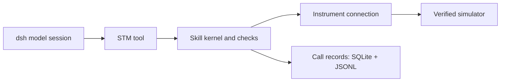

# dsh-spm

English | [简体中文](README.zh-CN.md)

**An experimental-science toolkit for scanning tunneling and scanning probe microscopy (STM/SPM), implemented in TypeScript for DeepSeek Harness.**

`dsh-spm` brings instrument control, quantitative analysis and visual experimental memory into a common agent environment. Its aim is to support the full reasoning cycle of microscopy: establish measurement conditions, acquire evidence, compare observations, test a physical interpretation and choose the next experiment.

The project carries MAST's scientific and instrument-control capabilities into TypeScript and implements the visual-memory and metrology design developed in VISTA-SPM. DeepSeek Harness (dsh) supplies model orchestration, sessions, approvals and the application shell; this repository supplies the SPM domain tools and their integration with that host.

This combination makes the experimental record an active part of reasoning. Instrument readback establishes what an action achieved, archived images let the model revisit the evidence, and numerical tools connect visual patterns to physical quantities. Independently installed packages already support documented simulator workflows in native dsh model sessions; the visual harness is available as an opt-in implementation for further evaluation.

[Documentation](docs/README.md) · [Code and evidence](docs/REVIEW-GUIDE.md) · [STM-Bench runtime](docs/MINIMUM-USABLE.md) · [Nanonis simulator runtime](docs/NANONIS-SIMULATOR.md) · [Agent instructions](AGENTS.md)

## Why STM is difficult to automate

STM probes surfaces through the tunneling current between a sharp tip and a nearby sample. That current is approximately exponential in tip–sample distance: the sensitivity that enables atomic resolution also makes tiny disturbances consequential. Images reflect electronic structure as well as geometry; interpreting them requires a model of the measurement. See [Tersoff–Hamann theory](https://doi.org/10.1103/PhysRevB.31.805).

- **The tip state is only partly observable.** Images and spectra combine tip and sample responses, so they generally cannot uniquely identify the atomic configuration or electronic state of the tip apex.
- **The measurement conditions keep changing.** Thermal drift, piezoelectric creep and hysteresis complicate the relationship between commanded and actual position. Long measurements need repeated checks of spatial registration. See [research on scanner distortion](https://arxiv.org/abs/1611.00243).
- **Actions have a physical history.** Tip conditioning and manipulation can alter the tip or sample; restoring settings does not necessarily restore the previous physical state. Parameters that worked before a tip change may no longer work afterward, as demonstrated in [atom-manipulation experiments](https://doi.org/10.1038/s41467-022-35149-w).
- **Scientific judgment requires diagnosis.** A clear image alone does not establish trustworthy spectroscopy. Anomalies call for competing explanations, control measurements and a decision about whether to continue, recover or involve the operator.

These challenges make STM a compelling setting for research on autonomous experimental science. The agent must maintain a working account of the tip, sample and measurement conditions, then revise it as new observations arrive. A change in contrast may motivate a new bias, a repeated scan, a spectrum or a tip-conditioning step; the scientific value lies in choosing an informative intervention and interpreting its consequences. For the broader experimental motivation, see [MAST-public's introduction](https://github.com/HamsterPark/MAST-public).

### Why visual memory belongs in the experimental loop

**Representation is part of reasoning.** We put this principle into practice through interfaces that preserve the relationships among images, scan coordinates, physical units, and acquisition history. A model's ability to revisit a region, compare scans, or request a numerical measurement shapes how it tests a physical interpretation. The TypeScript visual tools make these operations available within the agent's reasoning cycle.

Atomic lattices, reconstructions, steps and adsorbates make STM images rich in spatial relationships. Their significance often emerges through comparison: the same area before and after a manipulation, opposite scan directions, or a feature measured under different tunneling conditions. Preserving those observations gives an agent access to evidence that may become relevant only later in the experiment.

[VISTA](https://arxiv.org/abs/2610.02200) provides a useful foundation for this approach: direct visual observations, lossless memory and active retrieval support reasoning over extended interactions. Our connection to STM is both spatial and experimental. Like the interactive tasks studied in ARC-AGI-3, a microscopy sequence asks the agent to infer relationships from images, intervene and use the resulting changes to refine its understanding. STM adds physical units, instrument dynamics and evolving tip–sample conditions. These demands motivate the combination of visual memory with quantitative metrology in VISTA-SPM and its TypeScript implementation here.

## One research program, complementary repositories

The projects address different parts of autonomous microscopy, with explicit interfaces between experimental execution, visual reasoning and evaluation:

| Project | Responsibility | Connection to dsh-spm |
|---|---|---|
| [MAST-public](https://github.com/HamsterPark/MAST-public) | Public subset of MAST's Python/LangGraph instrument runtime, skills, state feedback and experimental workflows | Provides the scientific and operational foundation for the TypeScript migration; MAST remains an independent system. |
| [VISTA-SPM](https://github.com/HamsterPark/VISTA-SPM) | Reusable framework for visual reasoning in microscopy: evidence archives, calibrated inspection, measurement, notes and controlled evaluation | Provides the Python reference design and exported reference results used to check the TypeScript visual tools. |
| **dsh-spm — this repository** | SPM tools, instrument connections, execution checks, records and visual-harness integration for DeepSeek Harness | Makes MAST-derived domain capabilities and the VISTA-SPM design available within dsh's TypeScript host and session lifecycle. |
| [STM-Bench](https://github.com/HamsterPark/STM-Bench) | Simulated microscopy environments, scientific scenarios, acquisition records and evidence-based evaluation | Provides a controlled instrument environment for runtime validation and a shared basis for studying experimental behavior. |

The central division is straightforward: **MAST supplies an instrument-control system; VISTA-SPM develops the visual reasoning framework; dsh-spm integrates these capabilities with a different agent host; STM-Bench supplies simulation and evaluation.** The reusable unit is the scientific interface—observations with physical coordinates, measurements with units, and actions with recorded outcomes—which can be implemented across runtimes.

## Visual reasoning and metrology in TypeScript

The [visual-memory package](packages/host/visual-memory/src/index.ts) turns the VISTA-SPM design into reusable services and model tools. It connects image interpretation to quantities that matter experimentally: feature positions, step heights, lattice or reconstruction periods, changes between scans and spectral signals.

| Capability | Scientific use | Implementation |
|---|---|---|
| Persistent frame archives | Revisit scans, channels, forward/backward directions, partial scans and spectra by stable frame ID | [Archive](packages/host/visual-memory/src/archive.ts) and [session service](packages/host/visual-memory/src/plugin.ts) |
| Calibrated inspection and readout | Crop or rerender a region, relate display coordinates to scan coordinates, and read values in physical units | [Views and readout](packages/host/visual-memory/src/views.ts) |
| Quantitative measurement | Extract line profiles, Fourier peaks, compact features, registered differences and statistics | [Measurement tools](packages/host/visual-memory/src/tools.ts) |
| Experimental notes | Preserve the model's evolving interpretation and current plan in `GUIDE.md` and `WORKING.md` | [Notes](packages/host/visual-memory/src/notes.ts) |
| Observation-aware execution | Deliver newly archived observations with tool results and sequence ordinary state-changing actions through an observation gate | [Runtime integration](packages/bundle/dsh-spm/src/visual-harness.ts) |

These tools return measurements that the model can relate to competing physical hypotheses. The same archive and analysis interfaces can also be composed around saved microscopy files, giving the visual layer value in retrospective analysis as well as instrument interaction. Reference-parity tests compare geometry, units, rendering and numerical outputs against fixtures exported from VISTA-SPM; the [visual-memory exporter](tools/spec-export/export_visual_memory.py) documents the source and records reference file hashes.

The minimal runtime enables this integration through `visualHarness` (off by default); the Nanonis simulator entry uses `scripts/native-session.ts --visual --save-dir <Nanonis session directory>` alongside its usual connection options. The implementation has unit, contract and reference-parity tests. Acceptance with a live model using the visual harness is a next validation milestone; the completed model-driven simulator records below concern the instrument workflows.

## From experimental constraints to execution checks

STM operations change instrument state. A successful command must be distinguished from a confirmed setting or scan state, and later actions depend on the state left behind. The plugin therefore combines model-facing contracts with execution checks, instrument readback and durable call records.

In the validated Nanonis workflow, the model reads state, sets a target bias, starts and stops scanning, and restores the bias. The acceptance check compares bias and scan state through an independent TCP connection and associates the model's tool events with local records. Instrument tools follow this execution path:



## What runs today

**Status: active development · experimental.** APIs, configuration and supported tools continue to evolve. Current acceptance covers the simulator workflows below; real-instrument validation is scheduled for Phase 8. Development priorities and evidence are collected in the [remaining work](docs/MIGRATION-TODO.md) and [review guide](docs/REVIEW-GUIDE.md).

The following Windows acceptance records were produced on **2026-09-21**. Each row identifies its own package; rebuilding the same filename produces a new artifact to verify.

| Runtime | Model-visible tools | Recorded result |
|---|---|---|
| Managed STM-Bench | `stm_hello`, `GetBias` | Package `8c510e…` installed in two independent homes. Real model calls returned bias matching an independent TCP read, with persisted results. A separate dispatcher check recorded failure after simulator disconnection. [Evidence](docs/handoff/minimum-usable-20260921.md) |
| Already-running Nanonis Mimea + STM Simulator | Hello, bias/current/Z/scan-status reads, `SetBias`, `StartScan`, `StopScan` | Package `b5a7ab…` completed installation and a real model workflow: 7 requests, 9 tool calls, verified bias changes and scan start/stop, with session/SQLite/JSONL records linked by call ID. [Evidence](docs/handoff/native-nanonis-20260921.md) |

The recorded Nanonis run covers Generic 5e / RT Release 15016 and verifies bias and scan state. Complete image acquisition, full client integration, other platforms and public npm distribution are further milestones. These dated records identify the packages and workflows evaluated; MAST's instrument experience informs the design, while dsh-spm's hardware acceptance is tracked separately.

## Engineering decisions to inspect

- **Keep execution accountable.** A tool passes through the skill kernel to the instrument connection; measured results and instrument calls are associated with its call ID. Runtime shutdown waits for in-flight calls before closing records. Start with [runtime wiring](packages/bundle/dsh-spm/src/minimal.ts) and the [shutdown regression test](packages/bundle/dsh-spm/src/minimal-lifecycle.test.ts).
- **Migrate behavior against a reference.** Exported schemas, traces and numerical fixtures make cross-language differences testable. Numerical tolerances belong to the operation; intentional differences have reasons and reconsideration criteria in the [deviation register](spec/deviations.md).
- **Test the assertions themselves.** The [mutation runner](tools/mutate/run.ts) establishes a passing baseline, applies a compilable defect and checks that the declared test scope detects it. Surviving and inconclusive mutations remain visible.
- **Make workflow dependencies explicit.** Composite workflows follow both direct calls and declared steps to compute transitive dependencies; unresolved dispatch is recorded explicitly. See the [dependency tests](packages/host/stm-skills/src/l0/tip-phase-deps.test.ts).
- **Isolate the upstream API.** Production code uses [compat](packages/host/compat/src/index.ts), backed by real-package contract tests and pinned dependencies. The minimum distribution packages internal workspace code and checks dependency identity after installation.

The [review guide](docs/REVIEW-GUIDE.md) connects these choices to specific implementations, tests and acceptance reports.

## Migration scope

A skill here is an executable operation with a parameter schema, preconditions and a result contract. The generated inventory currently marks **442 / 515 skills** and **112 / 165 modules** complete. Thirteen skills are intentionally excluded, leaving 60 in scope and reachable targets of 502 skills / 160 modules. See [progress.json](spec/progress.json) and the [remaining migration work](docs/MIGRATION-TODO.md).

`done` means a registered implementation, a generated specification, a reference model schema and at least one reference trace exist. It is a migration classification; the running profiles expose the explicit tool sets listed above. Full migration acceptance is defined in the [development guide](docs/DEVELOPMENT.md).

## Build and test

Use Node and pnpm as declared in [package.json](package.json). From the repository root:

```text
pnpm install --frozen-lockfile
pnpm build
pnpm test --project unit --project contract
```

These checks need no private MAST installation, model key or external simulator. The `integration` project additionally requires `STMSIM_PYTHON` / `STMSIM_ROOT`; it starts STM-Bench and is included when `pnpm test` is run without project selection.

For installation and model operation, choose the appropriate runtime guide above. STM-Bench is started and stopped by the plugin. The Nanonis path verifies an already-running Windows simulator and disconnects without closing it; its commands can change bias and scan state.

The [final candidate validation and publication boundary](docs/handoff/publication-ready-20260921.md) records the publication candidate and its checks. The [review guide](docs/REVIEW-GUIDE.md) also retains the earlier simulator acceptance and [historical CI failures](docs/RELEASE-TODO.md); these results refer to their own snapshots and artifact hashes.

## Repository map

| Path | Responsibility |
|---|---|
| `packages/host/kernel/` | Skill execution, units, parameter and safety checks |
| `packages/host/numerics/`, `vision/` | Numerical methods and image-analysis criteria |
| `packages/host/visual-memory/` | VISTA-SPM-derived archives, calibrated inspection, measurement and experimental notes |
| `packages/host/stm-skills/` | Tool adaptation, individual skills and composite workflows |
| `packages/host/stm-records/`, `stm-safety/`, `nanonis-files/`, `compat/` | Persistent records, safety service, file formats and dsh adaptation |
| `packages/instrument/` | TCP protocol, connections, state, watchdog and simulator process management |
| `packages/bundle/`, `scripts/` | Runtime composition, packaging, installation and acceptance tools |
| `packages/client/` | Dedicated client integration under development |
| `spec/`, `tools/spec-export/`, `tools/mutate/` | Reference evidence, deviations, progress, exporters and mutation drills |

## Working on the project

- [Documentation map](docs/README.md): choose a reading path for review, operation, development or project history.
- [AGENTS.md](AGENTS.md): task routing, boundaries and validation defaults for coding agents.
- [DEVELOPMENT.md](docs/DEVELOPMENT.md): migration acceptance, generation, tests and collaboration.
- [RELEASE-TODO.md](docs/RELEASE-TODO.md): publication preparation and recorded checks.
- [VISUAL-HARNESS.md](docs/VISUAL-HARNESS.md): scientific motivation and design decisions for visual perception (D12); the [runtime integration](packages/bundle/dsh-spm/src/visual-harness.ts) shows the current opt-in composition.
- [SOURCES.md](docs/SOURCES.md): provenance and third-party notices, including reference-derived fixtures and public-text normalization.

Licensed under [MIT](LICENSE). Third-party material retains the notices described in the source register.
